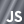
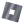
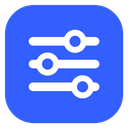

programmer for 7+ years, started out making roblox games in luau and never really stopped. these days its also unreal c++, cs2 maps, websites and browser extensions and etc. because i wanted to start working out of roblox luau since i understand multi coding languages and not just roblox luau.

<picture>
  <source media="(prefers-color-scheme: dark)" srcset="assets/games-dark.svg">
  
</picture>

<picture><source media="(prefers-color-scheme: dark)" srcset="assets/icons/unreal-dark.svg"></picture> <picture><source media="(prefers-color-scheme: dark)" srcset="assets/icons/cpp-dark.svg"></picture>&nbsp; <a href="https://github.com/1ypii/heft"><b>heft</b></a> custom particle physics in unreal engine 5, water cloth jelly and crates all hitting each other with no unreal physics in it 
<picture><source media="(prefers-color-scheme: dark)" srcset="assets/icons/cs2-dark.svg"></picture> <picture><source media="(prefers-color-scheme: dark)" srcset="assets/icons/js-dark.svg"></picture> <picture><source media="(prefers-color-scheme: dark)" srcset="assets/icons/css-dark.svg"></picture>&nbsp; <a href="https://github.com/1ypii/aimtraining"><b>aimtraining</b></a> cs2 workshop aim training map with its own round system and hud

<picture>
  <source media="(prefers-color-scheme: dark)" srcset="assets/sites-dark.svg">
  
</picture>

<picture><source media="(prefers-color-scheme: dark)" srcset="assets/icons/js-dark.svg"></picture> <picture><source media="(prefers-color-scheme: dark)" srcset="assets/icons/css-dark.svg"></picture> <picture><source media="(prefers-color-scheme: dark)" srcset="assets/icons/html-dark.svg"></picture>&nbsp; <a href="https://github.com/1ypii/roshipped"><b>roshipped</b></a> shows which games on the roblox front page shipped an update 
<picture><source media="(prefers-color-scheme: dark)" srcset="assets/icons/admin-dark.svg"></picture> <picture><source media="(prefers-color-scheme: dark)" srcset="assets/icons/js-dark.svg"></picture> <picture><source media="(prefers-color-scheme: dark)" srcset="assets/icons/css-dark.svg"></picture> <picture><source media="(prefers-color-scheme: dark)" srcset="assets/icons/html-dark.svg"></picture>&nbsp; <a href="https://github.com/1ypii/robloxadmins"><b>robloxadmins</b></a> who the official roblox administrators are 
 <picture><source media="(prefers-color-scheme: dark)" srcset="assets/icons/js-dark.svg"></picture> <picture><source media="(prefers-color-scheme: dark)" srcset="assets/icons/css-dark.svg"></picture> <picture><source media="(prefers-color-scheme: dark)" srcset="assets/icons/html-dark.svg"></picture>&nbsp; <a href="https://github.com/1ypii/verifieds"><b>verifieds</b></a> a list of verified roblox accounts 
<picture><source media="(prefers-color-scheme: dark)" srcset="assets/icons/js-dark.svg"></picture> <picture><source media="(prefers-color-scheme: dark)" srcset="assets/icons/css-dark.svg"></picture> <picture><source media="(prefers-color-scheme: dark)" srcset="assets/icons/html-dark.svg"></picture>&nbsp; <a href="https://github.com/1ypii/rocard"><b>rocard</b></a> turn any roblox username into a card mockup and export it as png or gif 
<picture><source media="(prefers-color-scheme: dark)" srcset="assets/icons/js-dark.svg"></picture> <picture><source media="(prefers-color-scheme: dark)" srcset="assets/icons/html-dark.svg"></picture> <picture><source media="(prefers-color-scheme: dark)" srcset="assets/icons/css-dark.svg"></picture>&nbsp; <a href="https://github.com/1ypii/linklab"><b>linklab</b></a> wireless headset audio link simulator you can actually hear 
<picture><source media="(prefers-color-scheme: dark)" srcset="assets/icons/js-dark.svg"></picture> <picture><source media="(prefers-color-scheme: dark)" srcset="assets/icons/css-dark.svg"></picture> <picture><source media="(prefers-color-scheme: dark)" srcset="assets/icons/html-dark.svg"></picture>&nbsp; <a href="https://github.com/1ypii/rohire"><b>rohire</b></a> roblox devforum jobs and for hire posts without the sellers and off topic posts 
<picture><source media="(prefers-color-scheme: dark)" srcset="assets/icons/html-dark.svg"></picture>&nbsp; <a href="https://github.com/1ypii/slime"><b>slime</b></a> black slime in a webgl shader that reaches for your cursor, grab it to stretch tear and throw it

<picture>
  <source media="(prefers-color-scheme: dark)" srcset="assets/extensions-dark.svg">
  
</picture>

 <picture><source media="(prefers-color-scheme: dark)" srcset="assets/icons/js-dark.svg"></picture> <picture><source media="(prefers-color-scheme: dark)" srcset="assets/icons/css-dark.svg"></picture>&nbsp; <a href="https://github.com/1ypii/Rola"><b>rola</b></a> quality of life features for the roblox website, styled to match it

 

more of my stuff is on [portfolioo.art](https://portfolioo.art)
